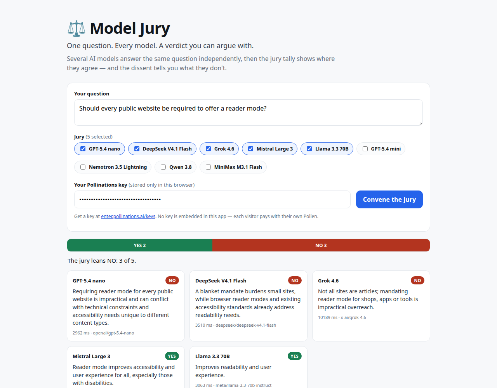

# ⚖️ Model Jury

**One question. Every model. A verdict you can argue with.**

Ask one yes/no question and several AI models — GPT, DeepSeek, Grok, Mistral, Llama, Qwen,
MiniMax — answer it **independently**, in parallel. The app turns their answers into a tally:
who said YES, who said NO, who abstained, and the one-sentence reason each juror gave. The
dissent is the interesting part.

Made with [pollinations.ai](https://pollinations.ai/?ref=badge).



## Live app

**https://svirepyibambr.github.io/model-jury/**

Static page on GitHub Pages. No backend, no embedded secrets.

## How it works

1. You pick the jury from 8 text models listed by
   `GET https://gen.pollinations.ai/v1/models`.
2. **Convene the jury** sends one `POST https://gen.pollinations.ai/v1/chat/completions`
   per model, in parallel, each with a juror system prompt asking for strict JSON:
   `{"verdict":"YES"|"NO"|"UNCLEAR","reason":"..."}`. See
   [`app.js`](https://github.com/SvirepyiBambr/model-jury/blob/main/app.js).
3. Answers are parsed tolerantly (JSON, fenced JSON, or plain text), then the tally bar,
   consensus line, per-juror latency and dissent cards are rendered client-side.

Bring your own Pollen: paste an `sk_...` key from
[enter.pollinations.ai/keys](https://enter.pollinations.ai/keys). The key is stored only in
`localStorage` in your browser and sent only to `gen.pollinations.ai`.

## Fairness notes

- Each juror sees **only the question** — never another model's answer.
- Jurors are told to commit to YES or NO; `UNCLEAR` is reserved for genuinely undecidable
  questions.
- Latency is displayed per model; slow jurors don't block the rest (`Promise.allSettled`).

## Run locally

```bash
python3 -m http.server 8080     # then open http://localhost:8080
```

No build step, no dependencies.

## Verification

- Live run with a real key: 5 jurors answered, tally 3 NO / 2 YES, all reasons rendered.
- Partial failures are surfaced per model without killing the rest of the jury.
- Empty key, empty question and empty jury are rejected with inline errors.
